# Creating Highly Available Web Applications Using EC2 Auto Scaling & Load Balancer

## Overview
This project demonstrates how I designed and deployed a scalable and highly available web application using EC2 Auto-Scaling and a Load Balancer. The system will automatically adjust capacity based on demand, which will ensure better performance and cost efficiency.

---

## Case Study
A growing e-commerce startup initially hosted its web application on a single EC2 instance. As user traffic increased due to marketing campaigns, the platform began experiencing slow performance and occasional downtime, revealing a single point of failure. How can an AWS cloud engineer solve these issues?

---

## Objective
- Deploy a web application on EC2 instances
- Configure Auto Scaling Group (ASG)
- Distribute traffic using an Application Load Balancer (ALB)
- Ensure high availability across multiple Availability Zones
- Automatically scale instances based on CPU utilisation

---

## Implementation Steps

### 1. VPC Infrastructure
- I created a VPC
- I created 2 public and private subnets 
- One of each subnets are intentionally placed in different availability zones for fault tolerance
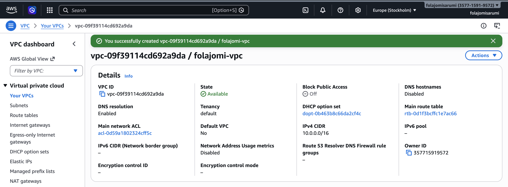
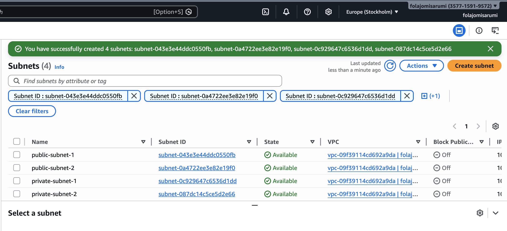

### 2. Internet Gateway, NAT Gateway & Route Tables
- I created an internet gateway & NAT Gateway to start work on internet access
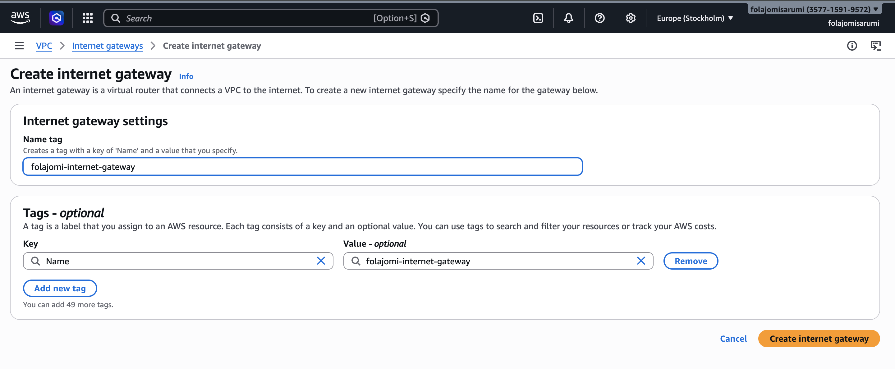
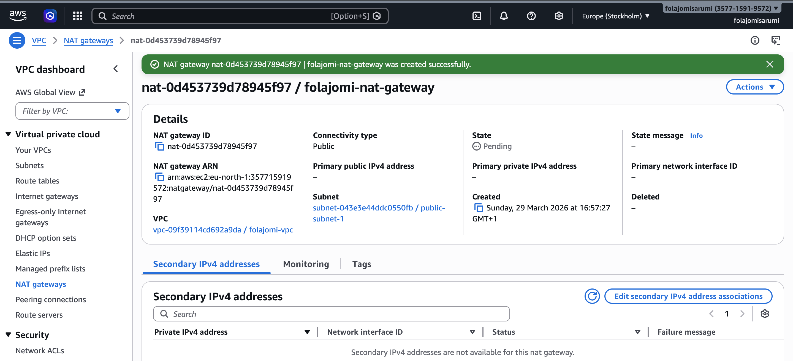

- I attached my internet gateway & NAT gateway to the VPC I created
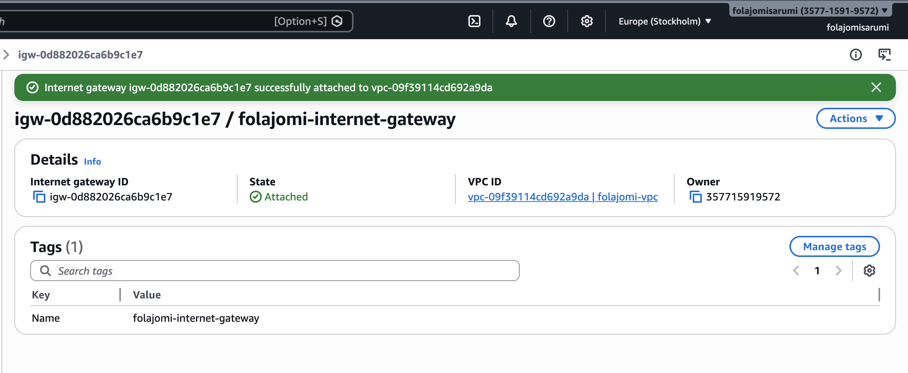

- I added the routes and subnet associations in my route table for internet connectivity 
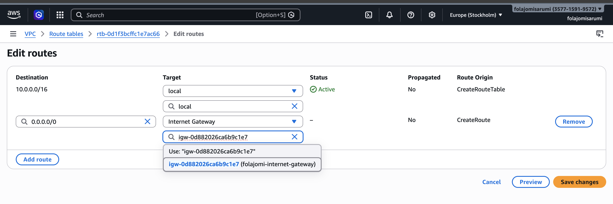
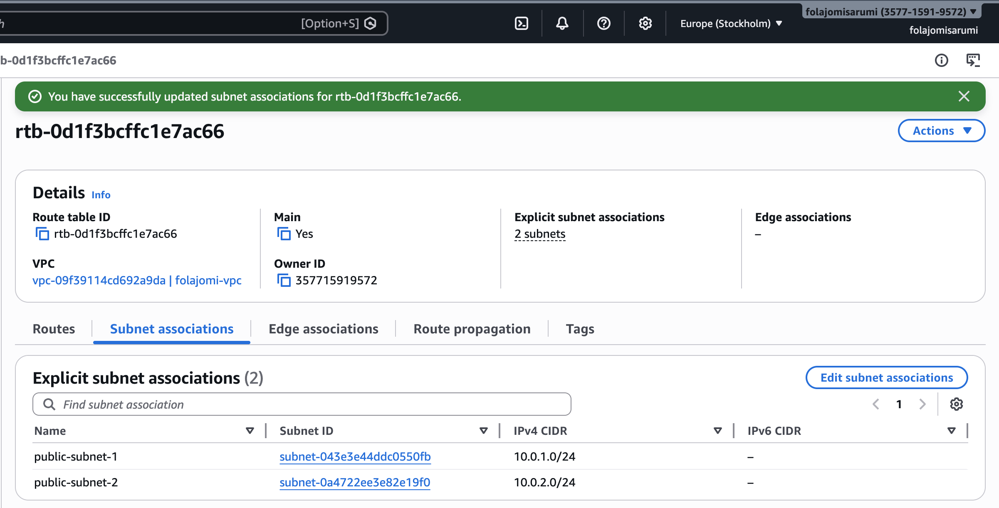
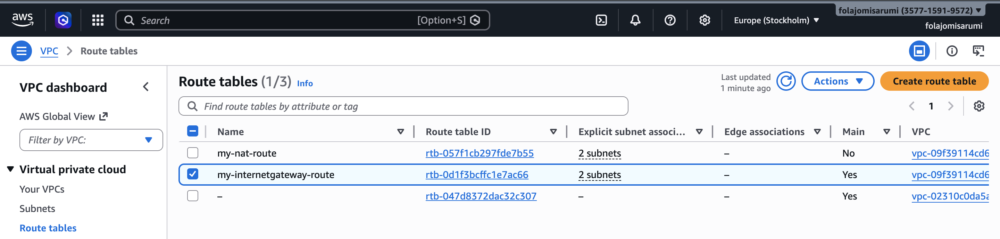

### 3. Created Launch Template  
- I configured 2 Amazon Linux AMI's with a t3.micro instance type.  
- The first instance is placed in a private subnet of the VPC I created
- I added a user data script to install and start a web server automatically on launch. 
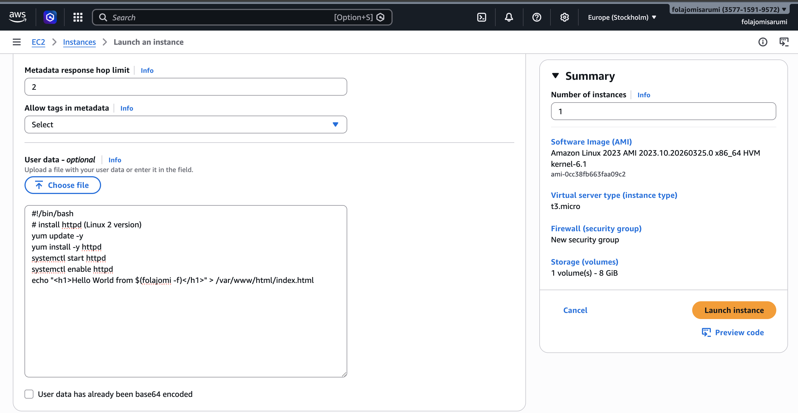 
- I created a security group and allowed SSH access from my local IP address 
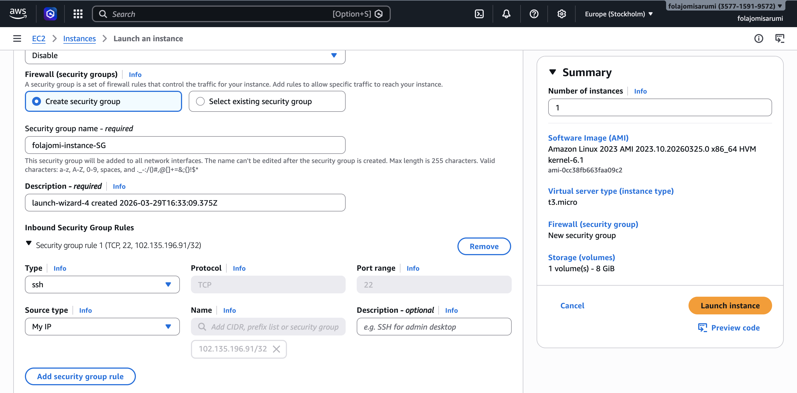 
- I repeated these steps for my 2nd instance

### 4. Set Up Application Load Balancer  
- I created an internet-facing Application Load Balancer.  
- I attached it to public subnets across multiple Availability Zones.  
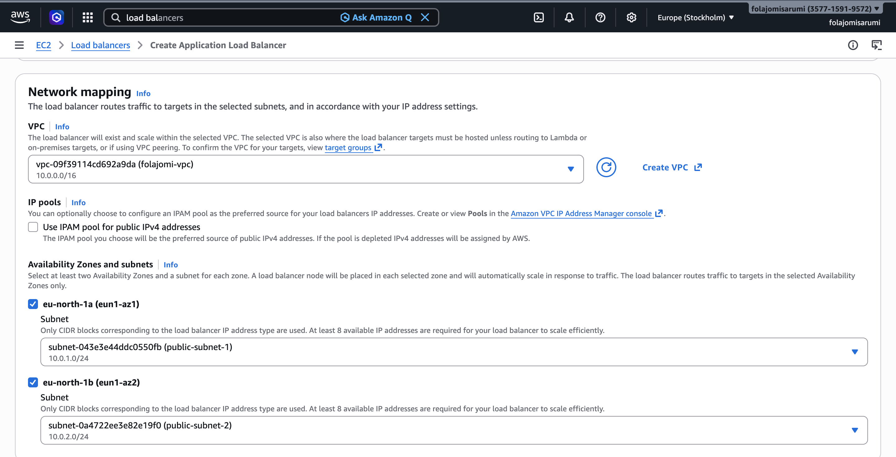
- I configured an HTTP listener on port 80 and linked it to a target group.  
- I created a new security group for my load balancer
- For my routing, I registered the targets to both my instances
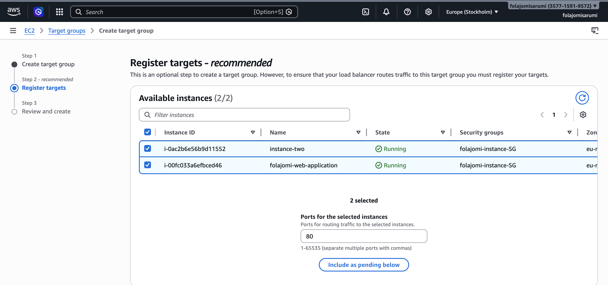
- After these steps I successfully created my load balancer
- I then set inbound rules on my instance security group to allow to send traffic to the instance, allowing my load balancer communicate with it.
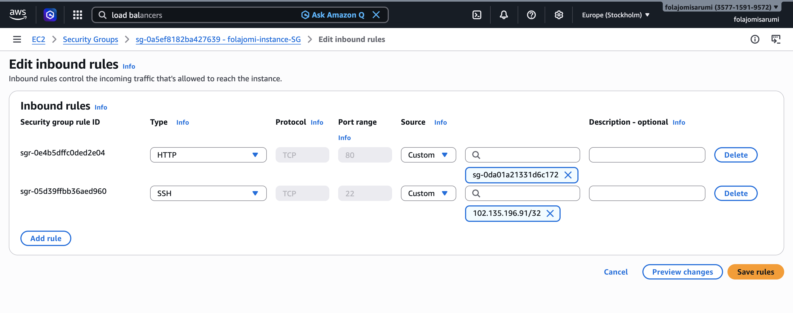
- Both targets are confirmed healthy
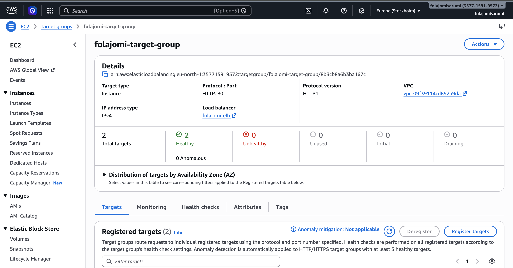
- Tested the DNS link on my load balancer and refreshed the page to make sure it routed to different instances

### 5. Created Auto Scaling Group  
- I created an Auto Scaling Group using the launch template.  
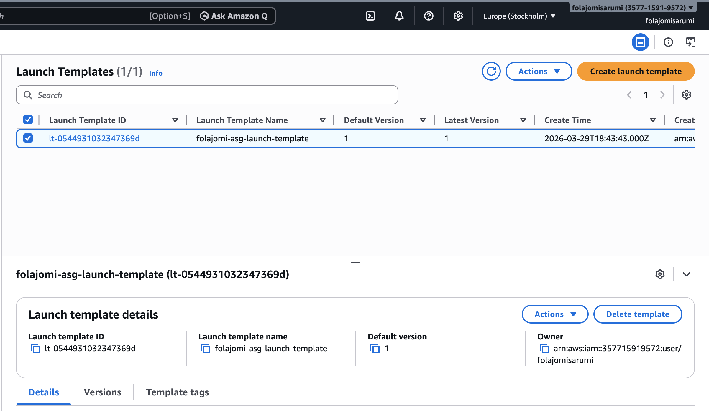
- I attached it to the target group and deployed it across multiple subnets.  
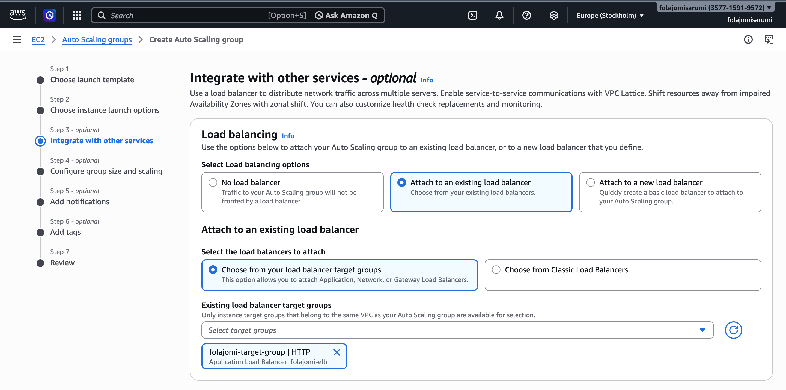
- I defined minimum, desired, and maximum capacity.  
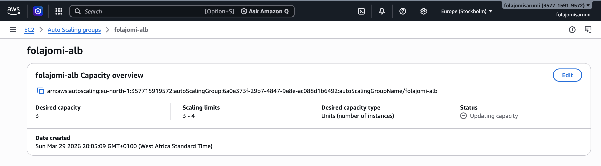

### 6. Configured Scaling Policies  
- I set a scale-out policy when CPU utilization exceeded 70%.  
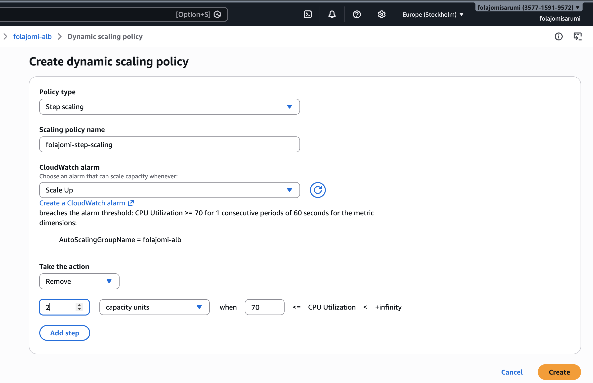
- I set a scale-in policy when CPU utilization dropped below 30%.  
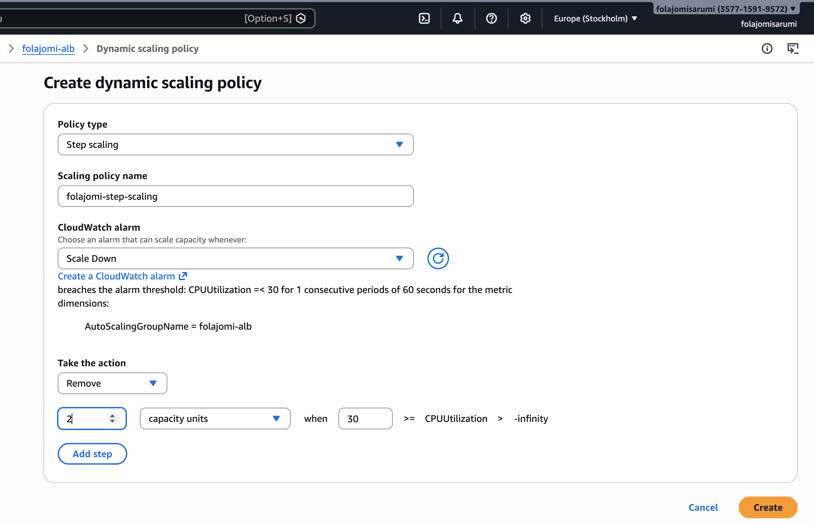

### 7. Configured CloudWatch Monitoring  
- I created CloudWatch alarms to monitor CPU utilization.  
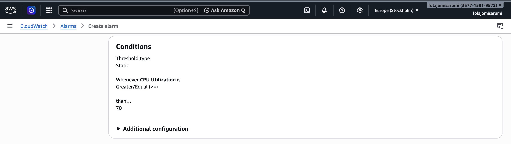
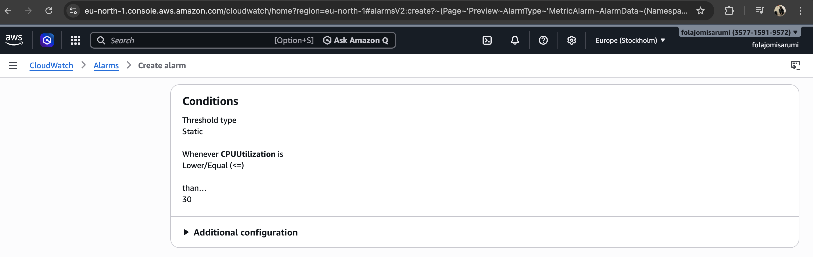
- I linked alarms to the Auto Scaling Group to trigger scaling actions.  

--

## Key Decisions

### Used Auto Scaling Groups 
- I used an Auto Scaling Group to automatically scale EC2 instances based on demand we get and ensure high availability through the process.  
- This removes the need for manual interventions when traffic increases or decreases.  

### Used Application Load Balancer  
- I used an Application Load Balancer to distribute traffic evenly across multiple EC2 instances based on demand.
- This efficiently improves application performance.  

### Deployed Across Multiple Availability Zones  
- I deployed resources across multiple Availability Zones to improve fault tolerance in our infrastructure. 
- This ensures the application remained available even if one Availability Zone failed.  

### Used Launch Template  
- I used a launch template to standardise EC2 configuration of Linux AMI's across all instances.  
- This ensured consistency and reduced configuration errors.  

### Used Dynamic Scaling Policies  
- I configured CPU Utilisation based scaling policies to automatically adjust capacity.  
- This allowed the system to scale out whenever there was high demand and scale in during low usage.  

### Used Cloud Watch Alarms
- I used Cloud Watch alarms to notify me with SNS topics whenever our cpu utilisation was too high, but also let my ASG know what to do in different situations.
- This reduces the need for manual intervention when dealing with demand.

---

## Outcome

### Improved Availability  
- My application remained available even when an EC2 instance(s) failed.  

### Eliminated Single Point of Failure  
- Traffic was distributed across multiple instances using the load balancer.  

### Achieved Automatic Scaling  
- The infrastructure automatically adjusted capacity based on demand.  

### Optimised Costs  
- The system scaled down during low traffic periods to reduce costs. 
