# IAM Access Control for Web Infrastructure

## Overview
This project demonstrates how I used IAM to securely manage access for different users and teams working on a web application hosted on AWS.

---

## Case Study
A company is deploying a static website hosted on S3. Multiple teams need access to AWS resources, but security must follow the principle of least privilege.

---

## Objective
- Design a secure IAM architecture for a web application environment, utilising role-based access control and custom policies to enable secure interaction between users and AWS services.

- Create EC2 instances, S3 buckets, outline policies and permissions, grant access to other key AWS resources such as CloudFront when applicable.

---

## Implementation Steps

### 1. Create IAM Users
- Created individual IAM users for each team member to have access to the AWS console

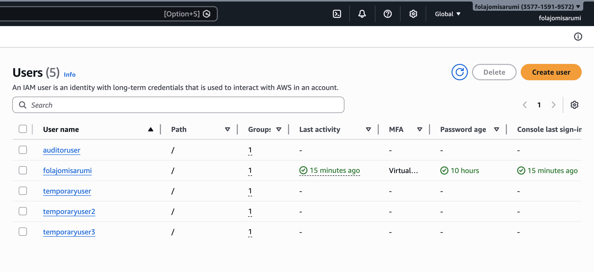

### 2. Create IAM Groups
- Created IAM groups to represent different teams:
  - Developers
  - DevOps
  - Auditors
- Assigned users to their respective groups:
  - Developers belong to the Developers group
  - Auditors belong to the Auditors group
  - DevOps members belong to the DevOps group
- This allows us to have permissions managed at scale instead of per user.

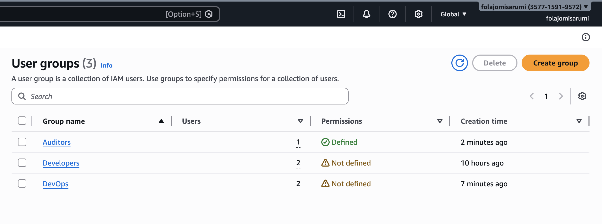

### 3. Attach Permissions to Groups

#### Developers
- Created a custom policy granting access to a specific S3 bucket
- Allowed actions:
  - Upload objects
  - View objects
- Restricted actions:
  - No bucket deletion
  - No IAM access

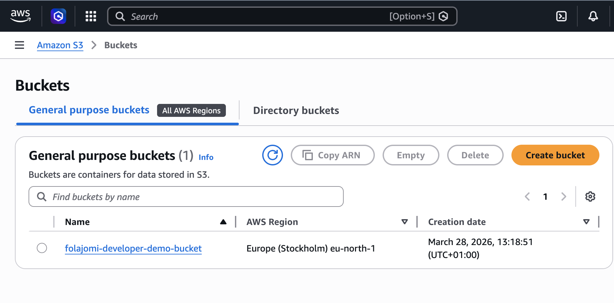

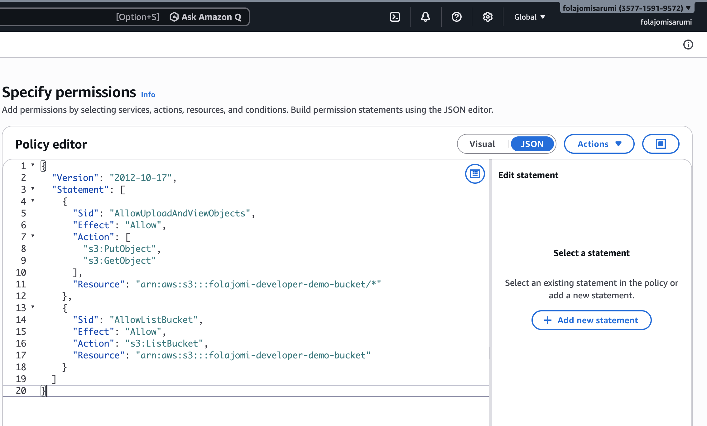

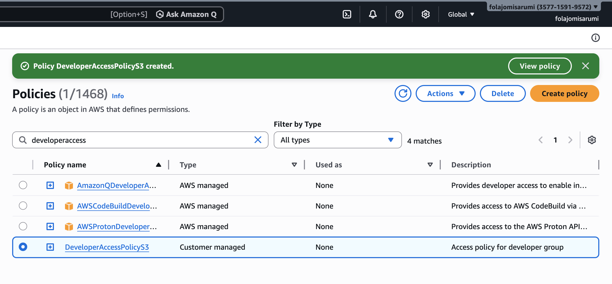

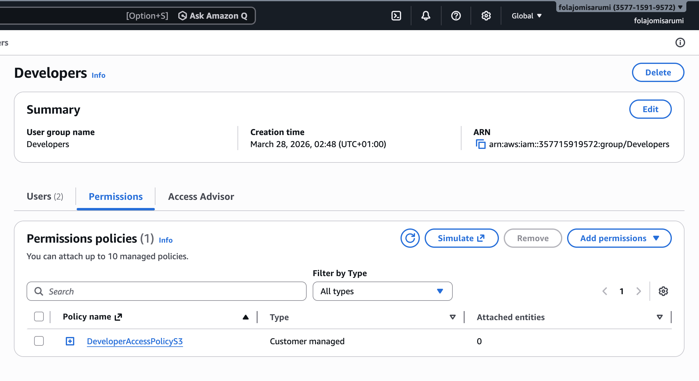

#### DevOps
- Assigned broader permissions to manage infrastructure
- Permissions include:
  - EC2
  - CloudFront
  - IAM (limited administrative control)

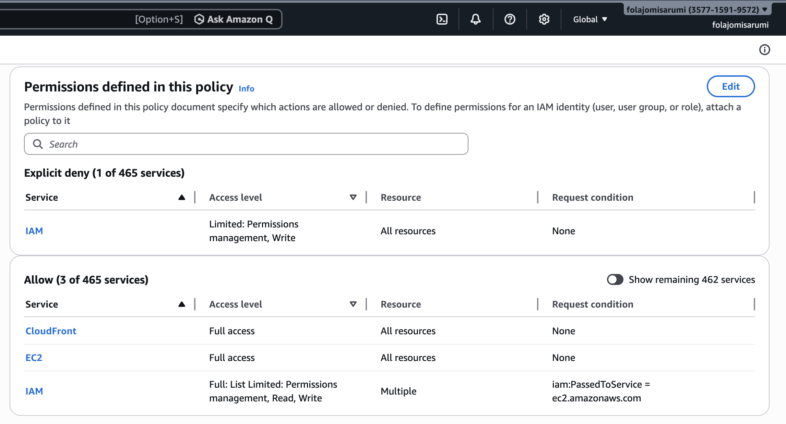

#### Auditors
- Attached AWS managed policy:
  - ReadOnlyAccess
- Allows viewing resources without modification

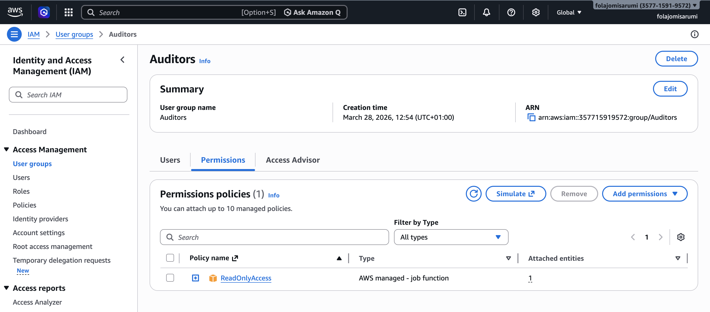

---

### 4. Create Custom IAM Policies
- Designed custom JSON policies to enforce least privilege
- Scoped permissions to specific resources (e.g., one S3 bucket)
- Tested policies to ensure correct access behavior

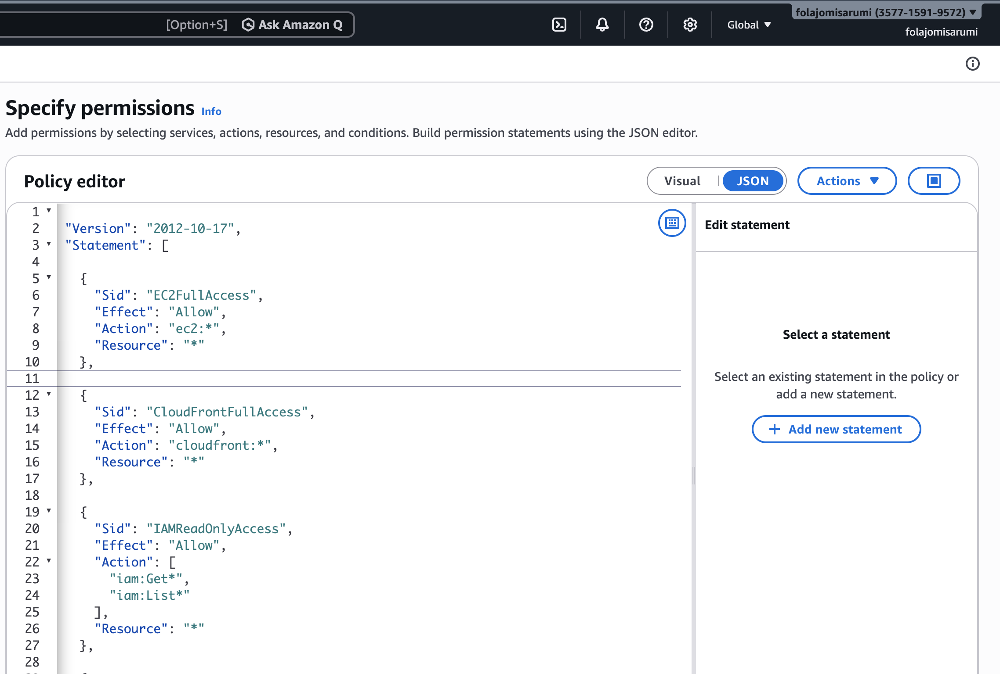

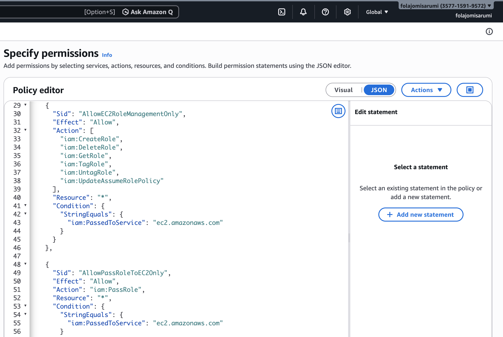

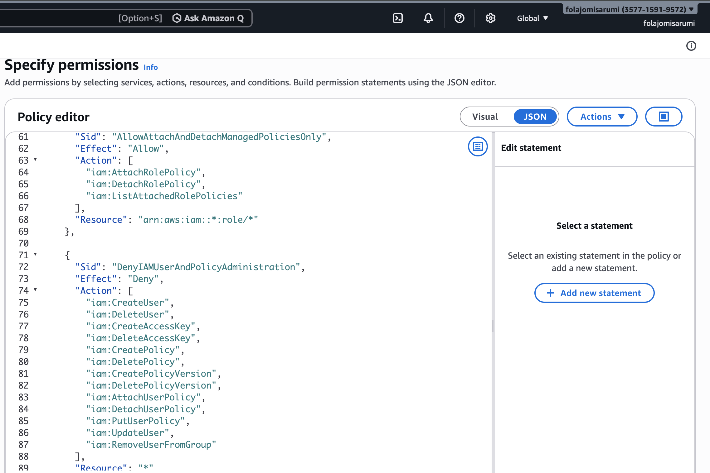

---

### 5. Implement IAM Roles for AWS Services
- Created an IAM role for EC2 instances
- Attached policy allowing access to S3 resources
- Configured trust relationship for EC2 service

- Purpose:
  - Enable secure service-to-service communication
  - Avoid use of hardcoded access keys

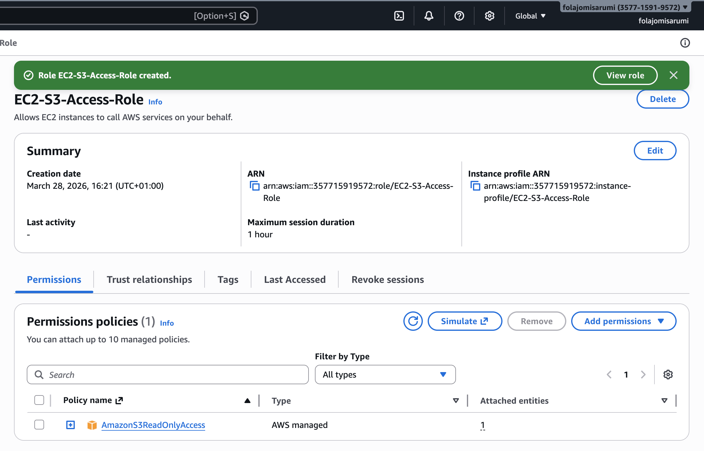

---

### 6. Assign Role to EC2 Instance
- Launched or configured an EC2 instance
- Attached the IAM role to the instance
- Verified access to S3 from EC2 without credentials

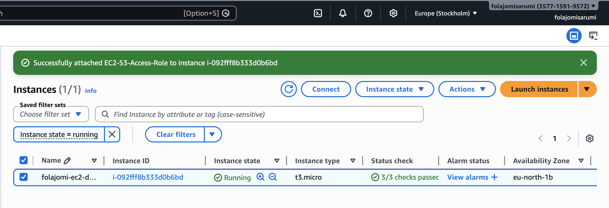

---

### 7. Enable Security Best Practices
- Enabled Multi-Factor Authentication (MFA) for IAM users
- Avoided use of root account for daily operations
- Followed the principle of least privilege across all roles and policies

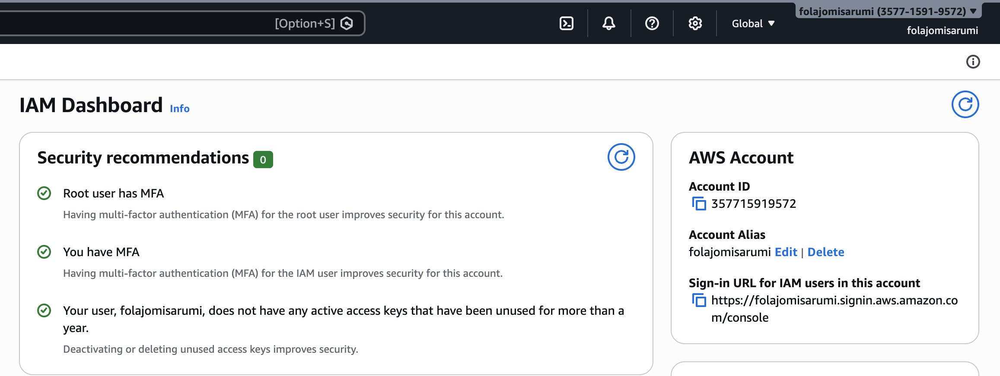

---

### 8. Testing and Validation
- Tested access for each user group:
  - Developers → Confirmed S3 access only
  - Auditors → Confirmed read-only access
  - DevOps → Confirmed broader infrastructure access
- Verified denied actions to ensure restrictions were working correctly

---

## Key Decisions

### 1. Used IAM Groups 
- I grouped users (Developers, DevOps, Auditors) to make access easier to manage and scale, rather than using individual permissions or inline policies.

### 2. Followed Least Privilege Principle
- Each group only got the permissions they needed and nothing more.

### 3. Used IAM Roles for EC2
- Instead of access keys, I used roles to securely connect EC2 to S3.

### 4. Separated User Types
- Different roles were created for Developers, DevOps, and Auditors teams to control and organise access clearly.

### 5. Used S3 for Hosting
- S3 was chosen because it is cheap, scalable, and good for static websites.

### 6. Added CloudFront
- CloudFront will enable the website to load faster globally.

### 7. Avoided Root Account
- All work was done using IAM users for better overall security.

---

## Outcome

- I successfully built a secure AWS environment using IAM best practices principles. I gave different user groups appropriate access based on their roles and nothing more, as access to other AWS resources were controlled using the least privilege principle.

- EC2 was able to securely access S3 using IAM roles without the need for access keys. 

- Overall, the project improved security, organisation, and scalability of the AWS setup.

---

## Learnings

- IAM groups help manage users more efficiently.
- Applying the principle of least privilege in real-world setups.
- Outlining the difference between IAM users, groups, and roles.
- Securely connecting EC2 to S3 using IAM roles instead of access keys.
- Adding CloudFront access to improve website speed and performance.
- Acknowledging the importance of not using the root account for everyday tasks.