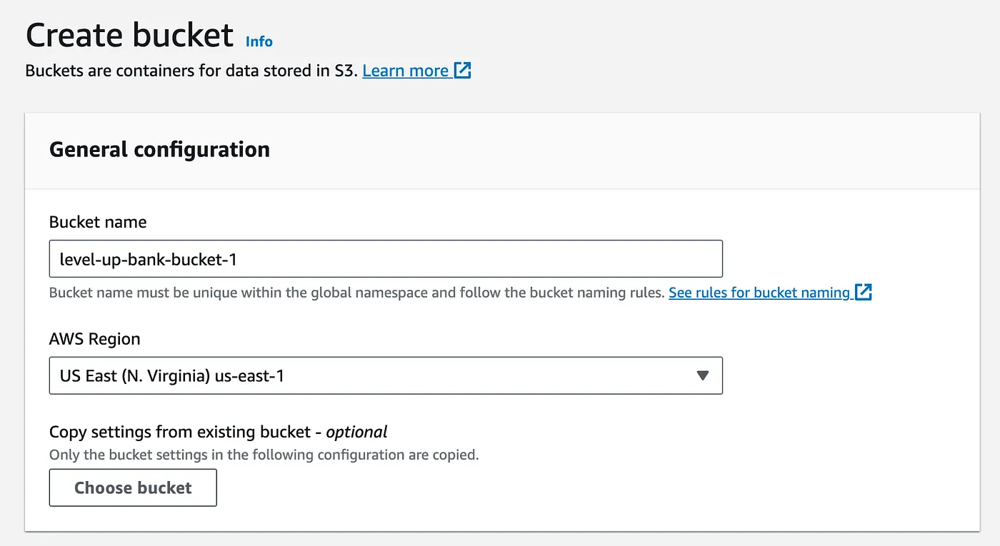
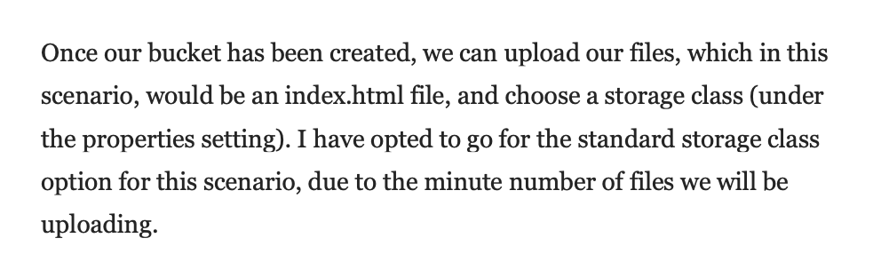
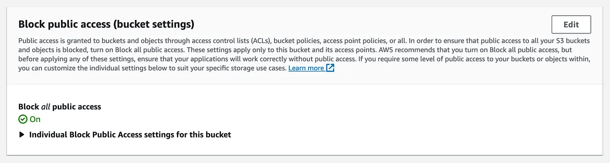
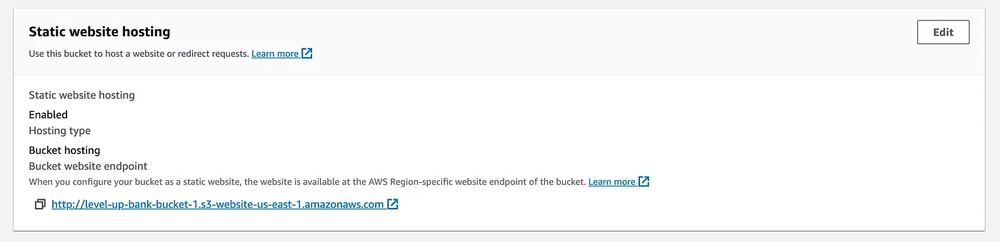
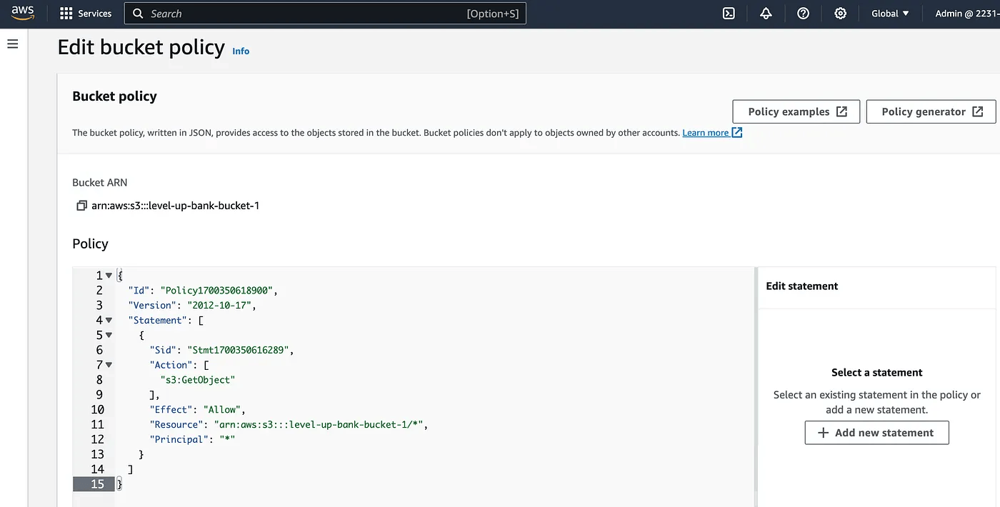

# Creating a Static Website with Amazon S3

## Case Study
Level Up Bank, a fintech startup, currently hosts its website on an on-premises server. This setup increases operational costs and limits scalability. The goal is to migrate to a cloud-based solution that is cost-effective, scalable, and highly available.

## Objective
- Host a static website using Amazon S3
- Ensure the website is publicly accessible via the S3 website endpoint (not the object URL)

## Implementation Steps

### 1. Created S3 Bucket
Created an S3 bucket to store the static website files.

### 2. Uploaded Files to Bucket
Uploaded website files (index.HTML) to the S3 bucket.

### 3. Configured Public Access Settings
Adjusted the public access settings to allow the bucket to serve content publicly.

### 4. Enabled Static Website Hosting
Enabled static website hosting and specified the index document.

### 5. Applied Bucket Policy
Added a bucket policy to allow public read access to objects.

### 6. Verified Website Accessibility
Confirmed that the website is accessible via the S3 website endpoint.

## Key Decisions
- Used Amazon S3 for static hosting due to its low cost, scalability, and high availability
- Used a bucket policy instead of IAM users to securely grant public read access with S3
- Enabled static website hosting to provide our content via our website endpoint

## Outcome
- Eliminated the need for on-premises infrastructure, reducing operational overhead
- Achieved a scalable and highly available solution
- Website is accessible globally via the S3 website endpoint

## Learnings
- Understanding the difference between object URLs and website endpoints is important for correct configuration
- Bucket policies are essential for balancing security and accessibility
- S3 static hosting is a simple and cost-effective solution for static websites