# VPC, Gateways and Private/Public Subnets

## Overview
This project demonstrates how I am able to create a VPC with public and private subnets in different availability zones to ensure fault tolerance. I will also be attaching Internet gateways, NAT gateways to my VPC to ensure internet access.

---

## Objective
- Create a Virtual Private Cloud that hosts multiple public subnets and private subnets that can hold resources such as load balancers and instances)
- Attach an internet gateway
- Attach a NAT gateway
- Create and connect a virtual machine

--

## Implementation Steps

### 1. Creating a VPC
- I went on the AWS console to access the VPC resource. I then created a VPC with the Ipv4 CIDR block 10.0.0.0/16

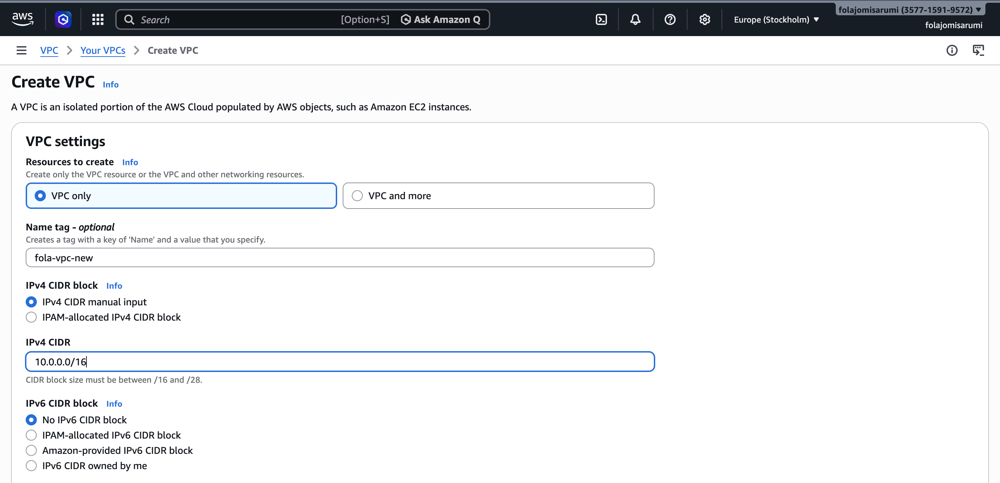
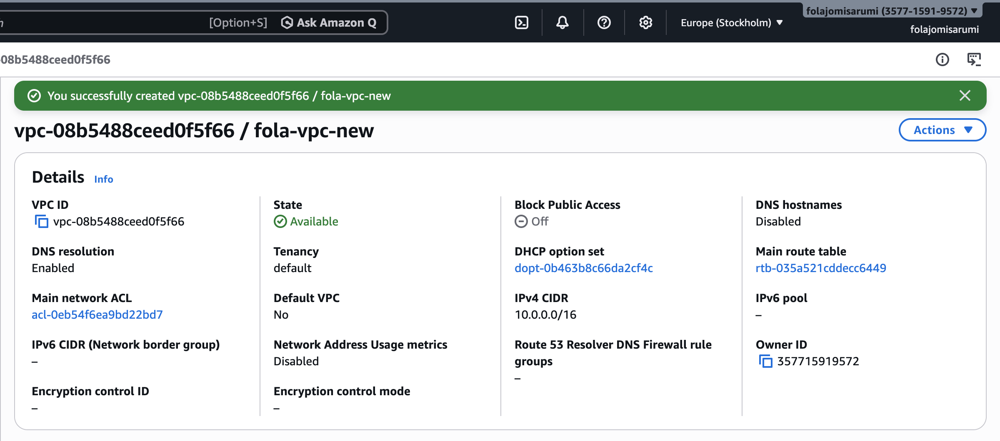

### 2. Creating Subnets
- Here I will be making 4 subnets, with both private and public have 2 subnets each. 2 public subnets will be places in 2 different availability zones to ensure fault tolerance and the same will be done for the private subnets. 

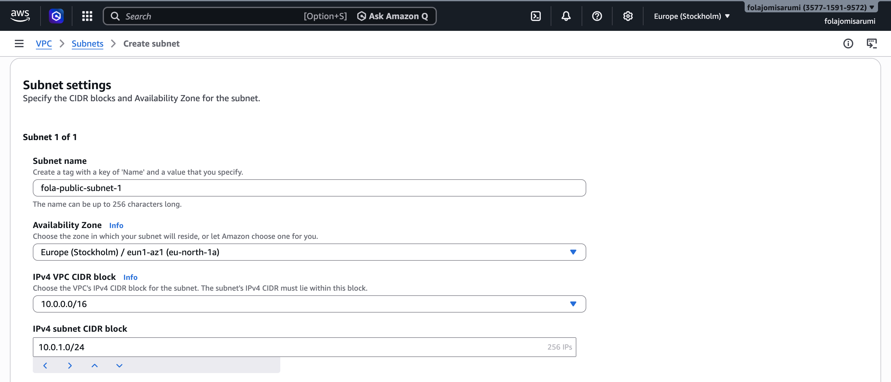

- My second public subnet intentionally has a different CIDR block and availability zone to my first public subnet.

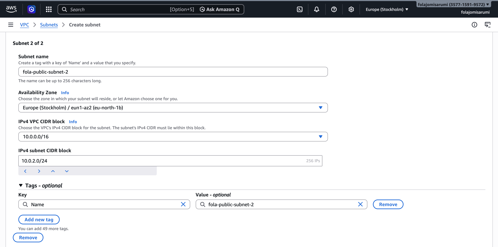

- All 4 subnets have been created

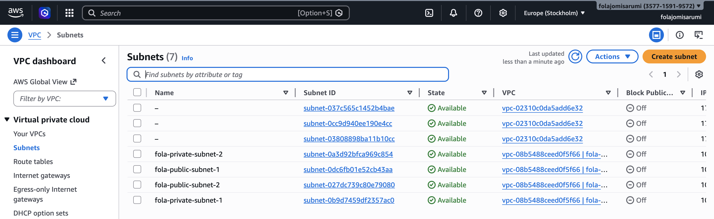

### 3. Creating Internet Gateway
- I created an internet gateway for internet access and attached it to my VPC

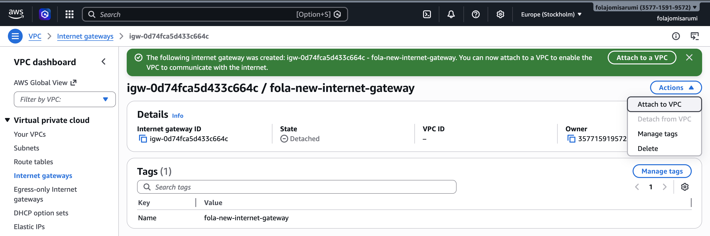
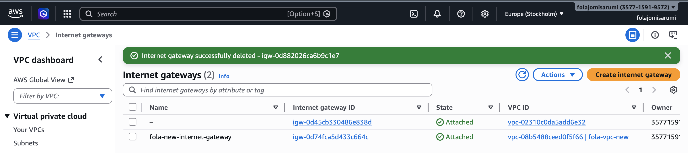

### 4. Creating NAT Gateway
- I created a NAT gateway attached to my VPC, and placed it in my public subnet

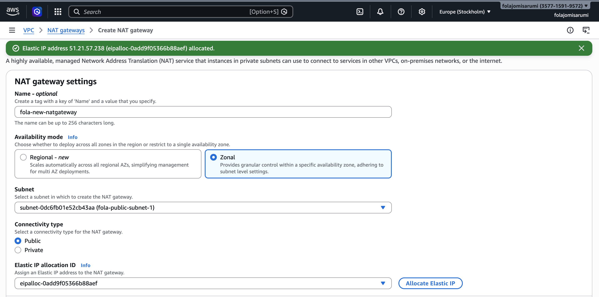

- I set the connectivity type to public because I want my virtual machines to have internet access before allocating an Elastic IP ID

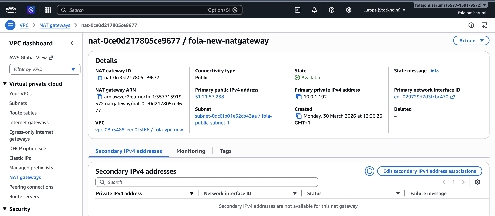

### 5. Route Tables
- I created a new route table and attached it to my VPC

- I then added routes for internet connectivity via the internet gateway

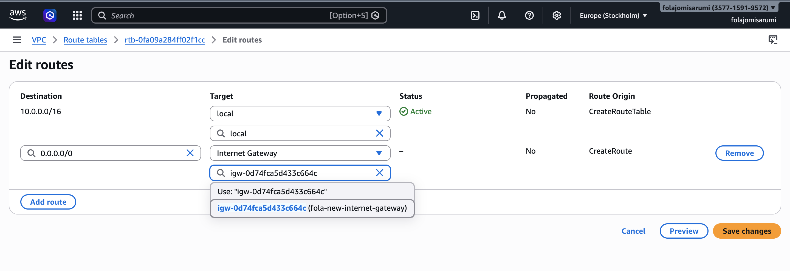

- I then gave both my public subnets explicit subnet associations on my internet gateway route table

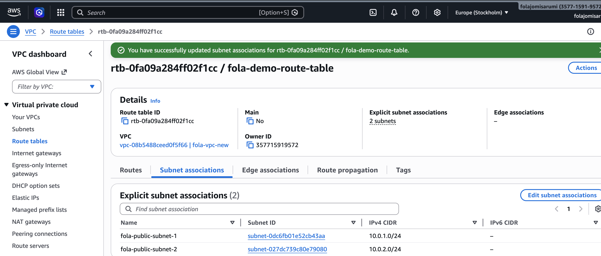

- I then created a new route table for my NAT gateway and edited the routes like I did for my internet gateway

- I then placed both my private subnets in my NAT gateway route table

### 6. Launching Instances
- I created 2 Instances (Amazon Linux AMI's) within my VPC network and placed them in my private subnets before creating a security group. Inbound rules were set to my IP so not every IP can access my instance

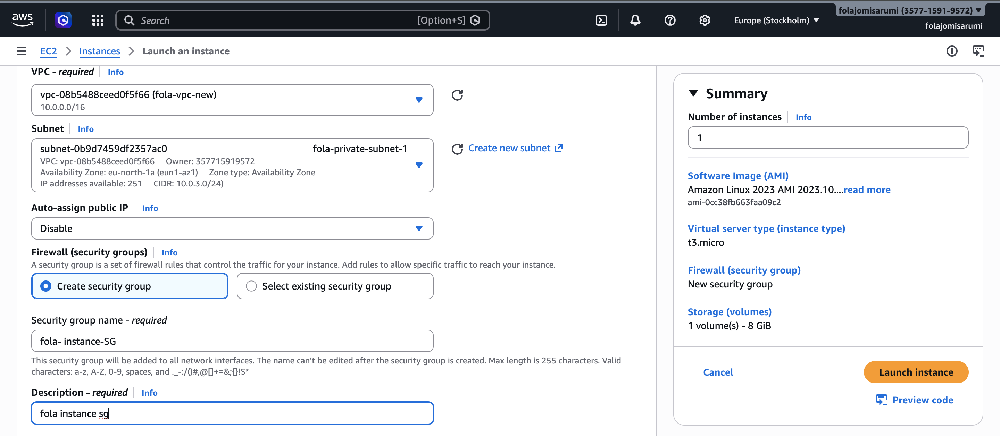

### 7. Creating Load Balancer
- I created an application load balancer to control traffic of my instances. I then put both my public subnets in 2 different availability zones.

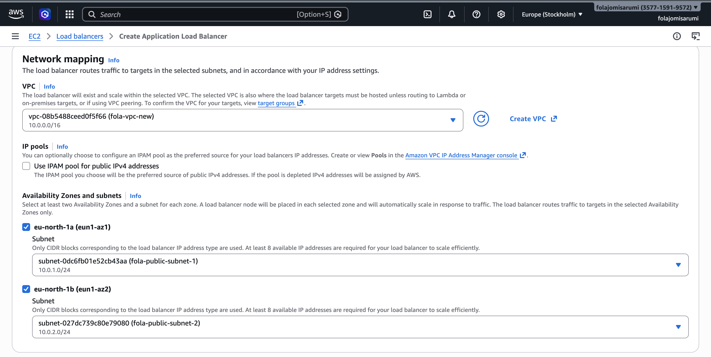

- I then created a new security group for my instance and added target groups

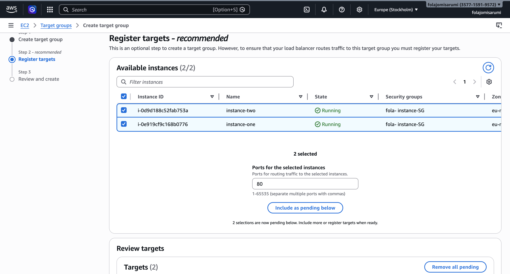

- I edited the inbound rules on my instance security group to communicate my load balancer

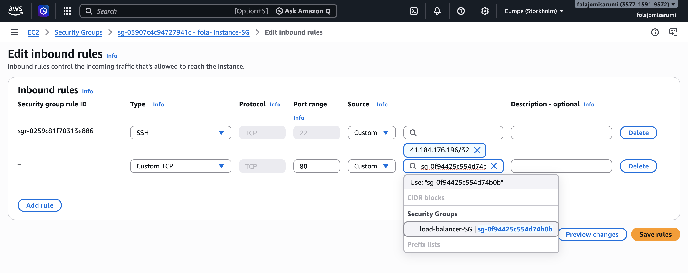

